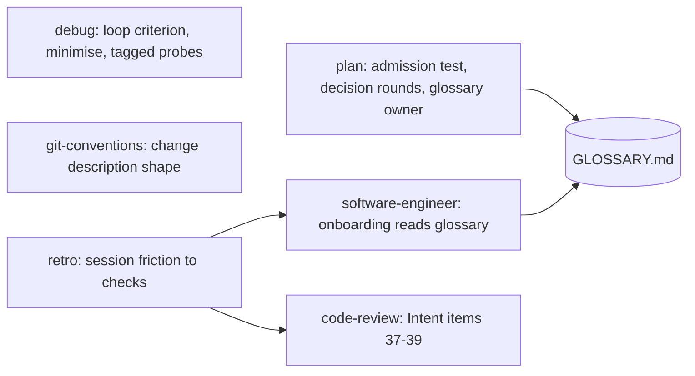

# workflow-enhancements — Design Doc

## Context

ni 2.1.0 leads every scenario of the ni-bench matrix (run-20261018-070444, n=3, Sonnet 5.5 subject) on judged quality. Its one losing KPI is cost and verbosity on the complex planning scenario: 3.2× the no-plugin baseline in cost, verbosity score 68 against 78 to 80 for the other arms, and four ADRs where two decisions were hard to reverse. Reading the trial dirs of that run and the earlier ones also showed workflow steps ni has no skill for: a change description with no required shape, a debug phase that reproduces but never names a tight loop or minimises, a review that checks a checklist but never the originating request, a domain model that dies with the workspace, a planning route that decides alone even when a human is present, and no step that turns a session's friction into a repository check.

Seven changes, all in the plugin's own voice and structure. The techniques are standard engineering practice: the three-test for architecture decisions, the reversibility call on a change, retrospectives, interview rounds, the glossary of domain-driven design, minimal reproductions. Nothing is copied from another skill set; no attribution line is added to NOTICE.

## Functional Requirements

### FR1 — ADR admission test
`skills/plan/complex-plan.md` Phase 3 replaces the open list "What warrants an ADR" (lines 140-147) with one admission test: an ADR is written only when all three hold, the decision is hard to reverse, a later reader would not guess why without the record, and real alternatives were weighed. The eight current kinds become examples under the test, not triggers. The small route keeps its own rule (SKILL.md lines 27-30). Decision: [ADR admission test](./adrs/adr-admission-test.md).

### FR2 — Design sections scale with the system
`skills/plan/templates/DESIGN.md` Design section (lines 53-62): C4 diagrams are required only when the system has more than one container; the STRIDE pass only when a flow crosses a trust boundary; a sequence diagram only per flow the design calls critical. Each omission is a one-line `N/A: <reason>`, already the template's rule (lines 3-4). `templates/preflight.md` line 23 keeps its wording; no new gate.

### FR3 — Change description shape
`skills/git-conventions/SKILL.md` "Change description" (lines 119-127) gains the required body shape: a summary led by the smallest visual that shows the change (a diff hunk, a file tree, a call list, a Mermaid diagram, or one sentence when nothing visual exists); evidence that it works, before and after (test output, a command and its result, a screenshot); a reversibility call, one-way or two-way door, with the blast radius in one line; the review checklist reference. The forge files keep their commands; `--body-file` and `--description-file` carry the shaped text.

### FR4 — Debug: tight loop, minimise, tagged probes
`skills/debug/SKILL.md` Phase 1 (lines 36-41) gains the loop criterion: before any hypothesis, one named command that has been run once, fails on this bug and not on a neighbour, gives the same verdict every run, finishes in seconds, and needs no human. Intermittent bugs: raise the reproduction rate first (loop the trigger, add stress, narrow timing) until the loop is reliable. A new minimise step: cut inputs, callers, config, and data one at a time, re-running the loop after each cut, until every remaining element is load-bearing; the minimal case becomes the regression test. `root-cause-tracing.md` Instrumentation (line 34) gains tagged probes: every temporary log line carries one prefix such as `[DEBUG-7f3a]`, so cleanup is one search and the Fix phase lists the search as a step. The evidence block (lines 65-85) is unchanged.

### FR5 — Review axis: intent
`skills/code-review/SKILL.md` checklist gains a category "Intent", items 37-39, assigned to subagent 2 (line 48): every requirement of the originating request, ticket, or plan has a corresponding change; nothing in the diff goes beyond that request; behaviours the request says to preserve are still exercised by a test. Findings use the existing one-line format with the item number. When no request is available, the category is skipped and the report says so.

### FR6 — Root glossary
A durable `GLOSSARY.md` at the project root, owned by the `plan` skill: one entry per domain term, definition in one or two sentences, the words it replaces, no implementation detail. `complex-plan.md`: Phase 4a's domain-model axis reads it first; Phase 6 integrate writes or updates it with the terms the workspace resolved (new step in `autopilot.md` Phase 6). `software-engineer/onboarding.md` adds reading it, when present, as part of Repository conventions. Every skill proceeds silently when the file is absent; none creates it outside a plan workspace. Decision: [Root glossary](./adrs/root-glossary.md).

### FR7 — Decision rounds
`complex-plan.md` Phase 3 opens with a decision round when a human is present: the agent lists every decision whose prerequisites are settled, numbers them, states its recommended answer for each, and phrases each so that "yes" accepts the recommendation. One round per message; answers reshape the next round; the round ends when no decision is open. Each accepted answer lands in DESIGN.md or, when it passes FR1, an ADR at `proposed`. The existing rule "Delegated and one-shot contexts: decide, do not ask" (SKILL.md lines 41-46) stays and skips the round. Decision: [Decision rounds](./adrs/decision-rounds.md).

### FR8 — Retro skill
New `skills/retro/SKILL.md`: after a session or on request, review what slowed or misled the agent and propose changes to the environment, never to the product code. Each finding is classed: a mechanical mistake becomes a deterministic check (lint rule, test, hook, CI job); a judgement call becomes a written convention (project CLAUDE.md, coding standard, glossary entry); a navigation gap becomes a pointer in docs. Output is a severity-ordered table, one row per finding with the proposed check, applied only after approval. Evidence rules from `evidence-based-analysis`. README skills table row, `commands/help.md` line, version bump.

### FR9 — Release
`.claude-plugin/plugin.json` version 2.1.0 → 2.2.0; `.github/scripts/docs.test.sh` `test_plugin_version_is_2_1_0` (line 274) follows; README release notes name the seven changes in one line each.

## Non-Functional Requirements

### NFR1 — Plugin validity
- **Scenario**: every edit done → the plugin loads
- **Measure**: pass/fail
- **Verify**: `claude plugin validate . --strict`

### NFR2 — Docs lint
- **Scenario**: every skill file through the CI lint (forbidden literals, shell-isms, link lint, shipped tree, version)
- **Measure**: pass/fail
- **Verify**: `bash .github/scripts/docs.test.sh`

### NFR3 — Skill size
- **Scenario**: every touched SKILL.md after the edits
- **Measure**: under 300 lines; `debug`, `tdd`, `git-conventions` under 150
- **Verify**: `wc -l skills/*/SKILL.md`

### NFR4 — Original text
- **Scenario**: the whole worktree searched for the names of other skill sets and their authors
- **Measure**: zero matches outside `docs/workspace` (which may name the benchmark)
- **Verify**: `manual: search the worktree for the names of other skill sets and their authors; the only hits allowed are the existing NOTICE and debug credit and the README benchmark table`

### NFR5 — Trigger test for the new skill
- **Scenario**: a prompt "what should we change so this does not happen again" with `--plugin-dir .`
- **Measure**: `retro` loads; a prompt "fix the failing test" does not load it
- **Verify**: `manual: claude --plugin-dir . --model haiku -p "<prompt>"` and read the loaded skill list

## Non-goals

- Parallel execution of ready tasks in autopilot: a change to the orchestrator loop, deferred to its own workspace.
- A handoff file or a phase-boundary decision tree: deferred with the above.
- A separate spec or ticket format: DESIGN.md and TASKS.md already carry requirements and tasks with dependencies.
- Changing the small route beyond FR1's example list: the benchmark shows it at parity on cost.
- Test doubles and seam guidance in `tdd`: out of the seven rows chosen.

## Rabbit holes

- Rewriting `complex-plan.md` wholesale. It is 225 lines and the human-time budget depends on its structure; FR1, FR6, FR7 are inserts and one replaced list, nothing else.
- Making the decision round a general interview skill. It lives inside Phase 3 only; `grilling the user` on every task is noise.
- Letting `retro` edit product code "while it is there". Boundaries forbid it.
- The glossary becoming a spec. One line per term; the ADR fixes the format.

## Failure modes

| Failure | Detection | Response | Blast radius |
|---|---|---|---|
| A skill crosses 300 lines after the insert | NFR3 `wc -l` | move the section to a sibling reference file linked from SKILL.md | one skill |
| New text trips the docs lint (literal, shell-ism, unlinked `.md`) | NFR2 | rewrite the line; never relax the lint | one file |
| Version test not updated with the bump | NFR2 `test_plugin_version_is_2_1_0` fails | update the test with the bump in the same commit | release |
| `retro` fires on ordinary debugging prompts | NFR5 second prompt loads it | tighten the description triggers | one skill |
| Decision round asks in a delegated context | reviewer reads Phase 3 and SKILL.md lines 41-46 | the round text opens with the delegated-context exception | plan skill |
| Glossary created outside a plan workspace by another skill | review of the onboarding text | onboarding reads only; creation stays in Phase 6 | repo hygiene |

## Design

No runtime: every change is markdown under `skills/`, `commands/`, `README.md`, the manifest, and one lint test. The skill graph after the change:

Trust boundaries: none crossed; no shell, no network, no credential. STRIDE: `N/A: markdown only`.

Decisions:
- [ADR admission test](./adrs/adr-admission-test.md)
- [Root glossary](./adrs/root-glossary.md)
- [Decision rounds](./adrs/decision-rounds.md)

## Data & migration
N/A: no persistence. Existing workspaces keep working: Phase 3 and Phase 6 inserts apply from the next plan; a repo without `GLOSSARY.md` behaves as before.

## Cross-cutting Concerns
- Rollout: one PR, version 2.2.0, users receive it on the version change.
- Rollback: revert the PR; no state outside the files.
- Observability: the next ni-bench matrix on the same subject model is the measure for plan-complex cost and verbosity.
