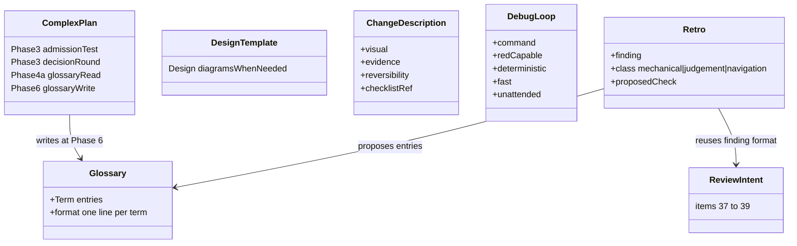

# workflow-enhancements — Tasks

Design: [DESIGN.md](./DESIGN.md)

## Analysis

Build: `claude plugin validate .` — verified green at plan time (`--strict` only at Phase 6, see below)
Test: `LC_ALL=C bash .github/scripts/docs.test.sh` — verified green at plan time
Lint: same script (forbidden literals, shell-isms, link lint, shipped tree, version)

### Known-failing tests
| Test | Reason | Action |
|---|---|---|
| `test_software_engineer_files` (docs lint) | glob order of `skills/software-engineer/*` is locale-dependent on this host (`onboarding.md` before `SKILL.md`); CI runs on Linux with the C locale and passes | run the lint as `LC_ALL=C bash .github/scripts/docs.test.sh`; fixing the test's sort is out of scope |
| `claude plugin validate . --strict` | the root `CLAUDE.md` resume anchor is a warning, and `--strict` turns warnings into errors; the lint tolerates `docs` and `CLAUDE.md` off main and the last PR commit removes them | run `claude plugin validate .` during sessions; `--strict` at Phase 6 after the anchor is removed |

### Domain model

Markdown only; the "types" are the files and the sections that own each rule.

### Requirement traceability

| Type / section | Stability | Addresses | Notes |
|---|---|---|---|
| `complex-plan.md` Phase 3 admission test | published | [FR1](./DESIGN.md#fr1) | read by every future workspace; wording change only, additive |
| `templates/DESIGN.md` Design section | published | [FR2](./DESIGN.md#fr2) | existing `N/A` rule unchanged |
| `git-conventions/SKILL.md` Change description | published | [FR3](./DESIGN.md#fr3) | forge commands unchanged |
| `debug/SKILL.md` Phase 1, new Minimise step; `root-cause-tracing.md` Instrumentation | published | [FR4](./DESIGN.md#fr4) | evidence block unchanged |
| `code-review/SKILL.md` Intent items 37-39 | published | [FR5](./DESIGN.md#fr5) | item numbers are referenced in findings; append only |
| `GLOSSARY.md` format; `complex-plan.md` Phase 4a and `autopilot.md` Phase 6; `onboarding.md` step 6 | published | [FR6](./DESIGN.md#fr6) | format fixed by ADR |
| `complex-plan.md` Phase 3 decision round | published | [FR7](./DESIGN.md#fr7) | skipped under the delegated rule |
| `skills/retro/SKILL.md`, README row, `commands/help.md` line | published | [FR8](./DESIGN.md#fr8) | new skill, name `retro` |
| `plugin.json` version, `docs.test.sh` version test, README release notes | published | [FR9](./DESIGN.md#fr9) | 2.2.0 |

### Transformations

| Function | Input → Output | Invariant / Rule |
|---|---|---|
| admission test | candidate decision → ADR, DESIGN.md section, or glossary entry | ADR only when hard to reverse AND surprising later AND alternatives weighed |
| decision round | open decisions → numbered list with recommended answers | an item whose answer depends on an open item waits for the next round; skipped under the delegated rule |
| glossary write (Phase 6) | resolved terms → `GLOSSARY.md` entries | one line per term, alphabetical, no implementation detail; file created only here |
| glossary read (onboarding, Phase 4a) | `GLOSSARY.md` or nothing → vocabulary | absent file: proceed silently, never create |
| change description | diff → body with visual, evidence, reversibility, checklist ref | all four present; "one sentence" allowed as the visual when nothing visual exists |
| debug loop criterion | bug report → one command | run once already; red on this bug; same verdict every run; seconds; unattended; no hypothesis before it |
| minimise | reproducing case → minimal case | cut one element per run; stop when every remaining element is load-bearing |
| tagged probes | temporary log lines → cleanup | one prefix per investigation; Fix phase removes by search |
| review intent | request + diff → items 37-39 findings | skipped with a stated reason when no request exists |
| retro | session → severity-ordered table | each row classed mechanical, judgement, or navigation with its proposed check; applied after approval; never edits product code |

## Tasks

### 1. ADR admission test ([FR1](./DESIGN.md#fr1))
**Goal**: Phase 3 writes fewer, better-justified ADRs.
**Types**: `complex-plan.md` Phase 3 (lines 136-160)
**Constraints**:
- [ADR: admission test](./adrs/adr-admission-test.md) — the three criteria, all required; the eight kinds become examples
- Where a rejected candidate goes: DESIGN.md Design or Context, or the glossary
- `skills/plan/SKILL.md` small-route rule (lines 27-30) untouched
- `templates/adr.md` Problem section gains one line asking for the three criteria to be stated
**Tests**: none automated; NFR2 lint and NFR3 size after the edit
**Verify**: `bash .github/scripts/docs.test.sh`
**Acceptance criteria**:
- [ ] Phase 3 names the three criteria before any list of examples
- [ ] every former list item appears as an example or is routed to DESIGN.md or the glossary
- [ ] `wc -l skills/plan/complex-plan.md` under 300
**Depends on**: (none)
**Time-box**: ~30 min

### 2. Design sections scale with the system ([FR2](./DESIGN.md#fr2))
**Goal**: no C4, STRIDE, or sequence diagram on a system that does not need one.
**Types**: `templates/DESIGN.md` Design section (lines 53-62)
**Constraints**:
- C4 when more than one container; STRIDE when a flow crosses a trust boundary; sequence diagram per critical flow only
- `N/A: <reason>` wording per template lines 3-4; `templates/preflight.md` line 23 unchanged
- The `c4-graph` skill link, if present in the template, stays
**Tests**: none automated
**Verify**: `bash .github/scripts/docs.test.sh`
**Acceptance criteria**:
- [ ] each of the three artifacts has its condition stated in one sentence
- [ ] a one-container design can fill the section with prose and three `N/A` lines without violating the template
**Depends on**: (none)
**Time-box**: ~20 min

### 3. Change description shape ([FR3](./DESIGN.md#fr3))
**Goal**: every MR/PR body carries the same four parts.
**Types**: `git-conventions/SKILL.md` Change description (lines 119-127)
**Constraints**:
- Four parts: visual-led summary, before/after evidence, reversibility call with blast radius, checklist reference
- The visual list: diff hunk, file tree, call list, Mermaid; one sentence when nothing visual exists
- Reversibility vocabulary: one-way door (hard to undo: schema, public contract, data deletion) or two-way door; blast radius in one line
- Forge files unchanged; the body text goes through the existing `--body-file` / `--description-file`
- Lite voice, under 20 lines added; SKILL.md stays under 150 lines
**Tests**: none automated
**Verify**: `bash .github/scripts/docs.test.sh` and `wc -l skills/git-conventions/SKILL.md`
**Acceptance criteria**:
- [ ] the section lists the four parts in order with one Not/Yes example
- [ ] `git-conventions/SKILL.md` under 150 lines
**Depends on**: (none)
**Time-box**: ~30 min

### 4. Debug: tight loop, minimise, tagged probes ([FR4](./DESIGN.md#fr4))
**Goal**: no hypothesis before a loop exists; minimal case becomes the regression test; probes leave no trace.
**Types**: `debug/SKILL.md` Phase 1 (lines 36-41), new Minimise step, Phase 4 Fix (lines 59-63); `root-cause-tracing.md` Instrumentation (line 34)
**Constraints**:
- Loop criterion as five checks: run once already, red on this bug, same verdict every run, seconds, unattended
- Intermittent bugs: raise the reproduction rate before any hypothesis (loop the trigger, stress, narrow timing)
- Minimise: one cut per run, stop when every element is load-bearing, the minimal case is the regression test of Phase 4
- Tagged probes: one prefix per investigation such as `[DEBUG-7f3a]`; Phase 4 adds "remove every probe by searching the prefix"
- Evidence block (lines 65-85) and Three strikes unchanged; `debug/SKILL.md` under 150 lines, else the minimise text moves to `root-cause-tracing.md`
**Tests**: none automated
**Verify**: `bash .github/scripts/docs.test.sh` and `wc -l skills/debug/SKILL.md`
**Acceptance criteria**:
- [ ] Phase 1 ends with the five-check criterion and the sentence that no hypothesis precedes it
- [ ] a Minimise step exists between reproduction and hypothesis
- [ ] Phase 4 lists probe removal; Instrumentation names the prefix rule
- [ ] `debug/SKILL.md` under 150 lines
**Depends on**: (none)
**Time-box**: ~45 min

### 5. Review axis: intent ([FR5](./DESIGN.md#fr5))
**Goal**: a review checks the diff against what was asked.
**Types**: `code-review/SKILL.md` checklist (line 126 onward), step 2 split (line 48)
**Constraints**:
- New category "Intent", items 37-39, appended after Cross-cutting; subagent 2's range becomes 17-39
- Items: every requirement of the request has a change; nothing beyond the request; preserved behaviours still tested
- Skipped with a stated reason when no request, ticket, or plan is available
- Finding format unchanged (line 98)
**Tests**: none automated
**Verify**: `bash .github/scripts/docs.test.sh`
**Acceptance criteria**:
- [ ] items 37-39 exist with the three questions
- [ ] step 2 assigns 17-39 to subagent 2
- [ ] the skip rule is stated next to the category
**Depends on**: (none)
**Time-box**: ~20 min

### 6. Root glossary ([FR6](./DESIGN.md#fr6))
**Goal**: one durable vocabulary file, written at integration, read at onboarding.
**Types**: `complex-plan.md` Phase 4a domain-model axis (line 175) and Structure (lines 34-52); `autopilot.md` Phase 6 steps (lines 82-88); `software-engineer/onboarding.md` Repository conventions step
**Constraints**:
- [ADR: root glossary](./adrs/root-glossary.md) — format, owner, readers, absent-file rule
- Phase 6 gains one step: add or update the resolved terms in `GLOSSARY.md`, create the file only here
- Onboarding step 6 gains one sentence: read `GLOSSARY.md` when present
- Structure block shows `GLOSSARY.md` at the root with a one-line comment
- Docs lint: `ONBOARDING_STEPS` names stay; the onboarding step count stays 10
**Tests**: `test_onboarding_checklist` in the lint must stay green
**Verify**: `bash .github/scripts/docs.test.sh`
**Acceptance criteria**:
- [ ] Phase 6 has the glossary step with the format line
- [ ] Phase 4a reads the glossary first
- [ ] onboarding reads it when present and never creates it
**Depends on**: task 1
**Time-box**: ~40 min

### 7. Decision rounds ([FR7](./DESIGN.md#fr7))
**Goal**: Phase 3 batches the human's decisions.
**Types**: `complex-plan.md` Phase 3 (lines 136-160)
**Constraints**:
- [ADR: decision rounds](./adrs/decision-rounds.md) — shape, dependency rule, exit to ADR or DESIGN.md
- Opens with the delegated-context exception (SKILL.md lines 41-46 linked, not restated)
- Under 15 lines; one Not/Yes example of an item
- Human time budget block (lines 13-18): Phase 3 line reads "decision rounds, then ADR ratification"
**Tests**: none automated
**Verify**: `bash .github/scripts/docs.test.sh` and `wc -l skills/plan/complex-plan.md`
**Acceptance criteria**:
- [ ] Phase 3 opens with the round, then the admission test, then the lifecycle
- [ ] an item example shows decision, options, recommended answer
- [ ] `complex-plan.md` under 300 lines
**Depends on**: task 1
**Time-box**: ~40 min

### 8. Retro skill ([FR8](./DESIGN.md#fr8))
**Goal**: a session's friction becomes a check or a convention.
**Types**: new `skills/retro/SKILL.md`; `README.md` skills table (line 187+); `commands/help.md`
**Constraints**:
- Layout and voice per `skills/skill/SKILL.md` and `template.md`: frontmatter `name: retro`, description starting "Use when", sections When to use, Overview, Workflow, Classification, Boundaries
- Triggers: "what would have prevented this", "retro", "post-mortem", "lessons", "so this does not happen again", end of a session that went sideways
- Classification: mechanical → deterministic check (lint rule, test, hook, CI job); judgement → written convention (project CLAUDE.md, standard, glossary entry); navigation → pointer in docs
- Output: severity-ordered table, columns Finding, Evidence (`file:line` or transcript quote), Class, Proposed check; applied after approval only
- Boundaries: never edits product code; evidence rules link `evidence-based-analysis`; checks it adds must pass the project's own CI
- Under 150 lines; no shell-isms in fences (lint)
**Tests**: NFR5 trigger test, manual
**Verify**: `claude plugin validate . --strict` and `bash .github/scripts/docs.test.sh`
**Acceptance criteria**:
- [ ] `skills/retro/SKILL.md` exists, validates, under 150 lines
- [ ] README row and help line added
- [ ] trigger test: loads on the retro prompt, not on "fix the failing test"
**Depends on**: task 6 (glossary entry as a judgement outcome)
**Time-box**: ~60 min

### 9. Release 2.2.0 ([FR9](./DESIGN.md#fr9), [NFR1](./DESIGN.md#nfr1), [NFR2](./DESIGN.md#nfr2), [NFR4](./DESIGN.md#nfr4))
**Goal**: the version moves and every gate is green.
**Types**: `.claude-plugin/plugin.json` line 4; `.github/scripts/docs.test.sh` line 274 test; README release notes
**Constraints**:
- Version 2.2.0 in the manifest and the lint test, same commit
- README release notes: seven lines, one per change, no external names (NFR4)
- NFR4 search returns nothing
**Tests**: `test_plugin_version_is_2_2_0` (renamed)
**Verify**: `claude plugin validate . --strict` and `bash .github/scripts/docs.test.sh` and the NFR4 search
**Acceptance criteria**:
- [ ] both verify commands exit 0
- [ ] NFR4 search empty
- [ ] README release notes list the seven changes
**Depends on**: tasks 1-8
**Time-box**: ~20 min

## Sessions

### Session 1 — skill edits (~2.5H)
Tasks: 1, 2, 3, 4, 5
**Skills**: `ni:skill`, `ni:git-conventions`
**Checkpoint**: `LC_ALL=C bash .github/scripts/docs.test.sh` and `claude plugin validate .`
**Commit point**: yes — one commit per task (`docs(plan): ...`, `docs(git-conventions): ...`, `docs(debug): ...`, `docs(code-review): ...`)

### Session 2 — glossary, rounds, retro, release (~2.5H)
Tasks: 6, 7, 8, 9
**Skills**: `ni:skill`, `ni:git-conventions`, `ni:evidence-based-analysis`
**Checkpoint**: `LC_ALL=C bash .github/scripts/docs.test.sh` and `claude plugin validate .` and the NFR4 search; `--strict` after the Phase 6 anchor removal
**Commit point**: yes — `feat(retro): ...`, `docs(plan): ...`, `chore: bump plugin to 2.2.0`

## Quality gates (post-session review)
- [ ] Acceptance criteria: all green above
- [ ] Code review: text matches [DESIGN.md](./DESIGN.md) intent; one owner per rule, links not repeats
- [ ] Code organization: sections in the order `skills/skill/SKILL.md` prescribes; reference files one level deep
- [ ] Code quality: lite voice, sentences under 20 words, no filler
- [ ] Security review: no shell, no credential, no network in any new text
- [ ] Observability: next ni-bench matrix measures plan-complex cost and verbosity
- [ ] Performance: N/A, markdown only
