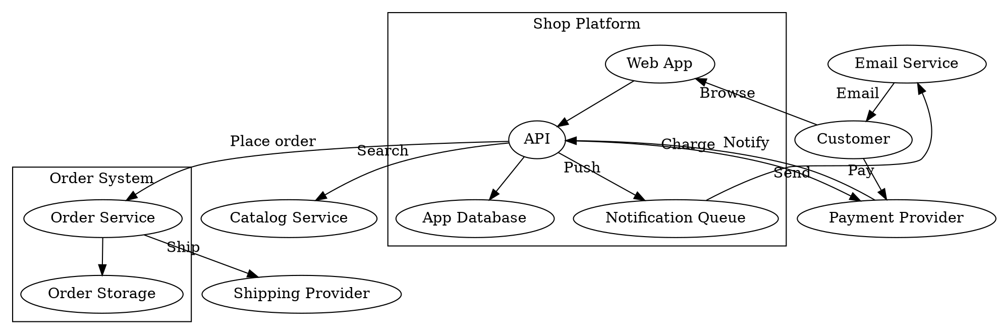

# Inputs, validation, and hand-over

Reference file of the [`c4-graph`](SKILL.md) skill. Read it when converting from a source, validating a produced diagram, or handing it over for rendering.

## Accepted inputs

| Input | How to read it |
|---|---|
| Text description | Derive nodes, edges (verb labels), boundaries; confirm element list with the user when ambiguous |
| DOT digraph | Each `"A" -> "B" [label="X"]` is one edge; `subgraph cluster_*` are boundaries |
| `.drawio` file | XML: `mxCell` with `vertex="1"` are nodes (C4 metadata in the wrapping `<object c4Name= c4Type= c4Technology= c4Description=>`), `edge="1"` with `source`/`target` ids are edges; edge labels may sit in a child `mxCell`. A compressed `<diagram>` holds base64 deflate: decode it with the interpreter one-liner below or ask for the uncompressed file (draw.io: Extras > Edit Diagram) |
| Editable `.drawio.svg` | The model is in the `<svg content="...">` attribute, HTML-escaped; unescape, then as `.drawio` |
| Pasted model | Often URL-encoded. Decode it with the interpreter present on the host (`python -c` or `node -e` one-liner), or paste the model and ask Claude to decode it |

Plain draw.io SVG export (no `content` attribute, base64 images inside): there is no model to extract. Reply with the procedure — open the diagram in draw.io, Extras > Edit Diagram, paste the XML here — and stop. Never guess edges from rendered paths.

Boundary membership: when the model does not parent nodes to a boundary cell, assign by geometry containment (node box inside boundary box). DOT carries boundaries only as `subgraph cluster_*`; without them, ask the user for boundary membership or emit a flat diagram and say so.

## Example input (DOT)

Styling attributes are ignored — only edges, their `label`/`xlabel`, and `cluster_*` subgraphs (boundaries) matter. A generic online shop, 11 nodes and 13 edges; the two clusters provide the ownership the roll-up needs:



An input over 15 elements splits along C4 levels per the Levels section of [drawio-rules.md](drawio-rules.md).

## Connectivity fidelity (convert mode)

The output must connect the same (source, target, label) multiset as the input.

1. List source edges, one `src -> dst [label]` per line, sorted.
2. List output edges: `grep -E 'edge="1"' <name>.drawio` gives one `mxCell` per relationship; its `source` and `target` ids map back to the `c4Name` of the wrapping `<object>`, the label is the object's `c4Description`. Write them in the same `src -> dst [label]` form, sorted.
3. `diff` both lists — any line is a missing or added edge; fix before handing over.
4. Edges with a missing endpoint in the source are dangling: list them to the user and ask intent; never silently drop or invent an endpoint.

Split outputs (several levels): check the deepest level first — the union of all Level 2 (and 3) edges must equal the source multiset. Then verify each Level 1/landscape edge is the roll-up of at least one source edge (container edges mapped to their owning system, labels combined with `, `). A Level 1 edge with no underlying source edge is an invention; a source edge with no rolled-up counterpart is a loss.

## Validate and hand over

Claude never renders. Validate the model, then hand it to the human, who renders and exports it. Commands follow the shell rules in [`software-engineer`](../software-engineer/SKILL.md#onboarding).

Parse check — the file is well-formed XML, with the interpreter present on the host:

```bash
python -c "import xml.dom.minidom; xml.dom.minidom.parse('<name>.drawio')"
```

Without an interpreter, VS Code reports a malformed file on open; say so in the hand-over.

Id check: every `source` and `target` in the `grep -E 'edge="1"'` output names an `id` of an `<object>` or `<mxCell vertex="1">` in the same file; every `parent` names a boundary id or `1`.

Hand-over steps, quoted to the user:

<!-- platform-table -->
| Host | Open and export |
|---|---|
| VS Code, any OS | Install the `hediet.vscode-drawio` extension; open `<name>.drawio`; Arrange > Layout > Vertical Flow; File > Export as > SVG with "Include a copy of my diagram" ticked, saved as `<name>.drawio.svg` |
| draw.io desktop or app.diagrams.net | File > Open `<name>.drawio`; same layout and export steps |

Then ask the user to check the preview: boundaries titled, every relationship labelled, arcs where arrows cross, white canvas on a dark theme. Markdown embeds the export with ``; the `.drawio` source stays beside it for the next edit.
